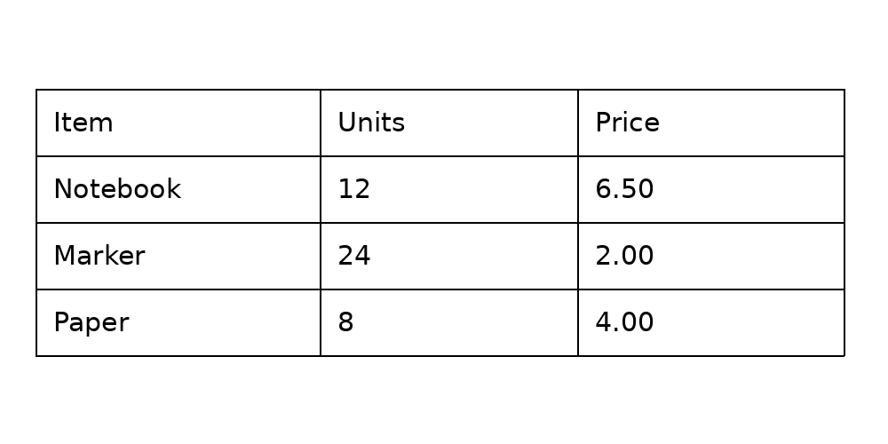

# 从表格图片恢复行列结构：SLANet+ 实测

[English](README.en.md) | 简体中文

扫描报表中的文字即使全部识别正确，丢失行列关系也难以计算或导入数据库。表格结构识别先预测单元格、行列和合并关系，让后续 OCR 文字能够填入正确位置。这里用一张自行绘制的表格检查 SLANet+ 如何处理表格周围的空白，并提供 CPU 复现脚本。



## 它在文档解析中做什么

完整的表格解析通常包括页面布局分析、表格区域检测与裁剪、表格结构识别、文字检测与识别，以及文字与单元格的空间匹配。本实验只运行其中的**结构识别**，并用人工已知坐标模拟上游裁剪；它没有识别单元格文字，也没有验证自动检测或完整 OCR 管线。

SLANet+ 输入表格图像，输出 HTML 风格的结构标记，以及结构分数等信息。例如 `<tr><td></td><td></td><td></td></tr>` 表示一行三个单元格，但不包含格内文字。模型通过特征提取、特征融合与结构解码预测单元格关系，详见 [Transformers SLANet 文档](https://huggingface.co/docs/transformers/model_doc/slanet)。[模型卡](https://huggingface.co/PaddlePaddle/SLANet_plus_safetensors)列出约 185 万参数和 Apache-2.0 许可。

## 这次看到了什么

自行绘制的英文表格有 4 行、3 列、12 个单元格，没有合并。两个输入来自同一幅图：原图为 1000 × 500，裁剪版按坐标 `(40, 100, 951, 401)` 截取表格区域，尺寸为 911 × 301。

| 输入 | 预测结构 | 结构分数 | 首次前向耗时 |
| --- | --- | ---: | ---: |
| 原图 | 多出一行跨 3 列的单元格，随后 4 行各 3 格 | 0.9784 | 0.212 s |
| 裁剪版 | 4 行各 3 格，与该图已知结构一致 | 0.99996 | 0.115 s |

这说明在**这一个样本**上，输入区域会影响结构输出；不能推广为裁剪一定提升效果。模型分数不是经过校准的正确率，原图分数很高仍出现了多余行。耗时各只有一次，且输入不同，不能用于判断裁剪带来的加速或设备性能。

运行环境为 DGX Spark 的 aarch64 CPU、2 个 PyTorch 线程，PyTorch 2.14.0+cu130、Transformers 5.17.0。计时仅覆盖模型首次前向，不包括加载、预处理和后处理。完整结构与原始数值见 [原图结果](results/uncropped.json)和[裁剪结果](results/cropped.json)。权重 `model.safetensors` 的 SHA-256 为 `4455fa2a535b80738e0e0af2ca899f719efb8d6e1c7e7209cc5126f81607bf06`；记录未保存模型仓库修订号，其他模型文件与软件版本变化可能影响复现。

在本实验目录运行 `python scripts/audit_results.py`，可以把两份历史结果的 HTML 标记解析为逐行单元格及合并跨度，并校验公开原图与原图记录的文件哈希。它只复核已保存的结构和数值，不重新运行模型，也不提供真实文档准确率。

## 复现

准备 Python 环境与 `torch`、`transformers`、`Pillow`，下载 [SLANet+ 权重](https://huggingface.co/PaddlePaddle/SLANet_plus_safetensors)到本地。脚本使用 Linux 的 `/usr/share/fonts/truetype/dejavu/DejaVuSans.ttf` 绘制输入；字体或 Pillow 版本不同可能产生不同图像。结果写到仓库外的新目录，已存在时脚本拒绝覆盖。

```bash
python scripts/slanet_table_smoke.py --model /path/to/SLANet_plus_safetensors --out /tmp/slanet-uncropped
python scripts/slanet_table_smoke.py --model /path/to/SLANet_plus_safetensors --out /tmp/slanet-cropped --crop-table
```

查看 `result.json` 的 `result.structure`，并与上面的已知行列结构比较。新运行记录所用的 `model_directory`，而非自动判断模型来源；`input_sha256` 和 `model_sha256` 可检查输入和权重是否与记录相同。路径只能标识本地位置，不能证明模型来源；历史结果里的 `model` 是该次实验记录的模型名。单张合成图只适合检查流程：要评估实际效果，还需要多样文档、合并单元格、真实标注和统一的结构指标，并分别衡量检测、OCR 与匹配误差。

新运行还记录 Pillow 版本和 `input_rgb_pixels_sha256`，后者针对按行排列的 RGB 原始像素；需与 `image_wh` 一起比较。PNG 文件字节哈希可能因编码方式而变化，即使像素相同也不一定相同。历史裁剪结果没有保存输入图片、像素哈希或 Pillow 版本，因此仅凭旧 `input_sha256` 不能确认现在重建的裁剪图与当时像素完全一致。
