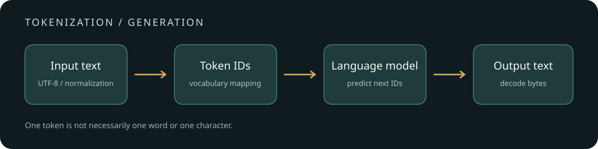

# From bytes to tokens: tokenization, generation and cost

[中文](README.md) | English

The same sentence can produce different token counts with different models. Tokenization determines how much context text occupies and affects APIs that charge per token. Understanding it helps estimate input size and diagnose decoding and truncation issues without treating characters as tokens.

This tutorial includes a byte-level BPE toy implementation and a comparison using real tokenizers. The examples illustrate encoding differences, not model rankings.



```text
text → normalization / pre-tokenization → vocabulary → token IDs → model
                                                  model-generated IDs → decoding → text
```

## Run a tiny byte-level BPE

Python 3 is sufficient; no model download is needed:

```bash
python toy_bpe.py
python ngrams.py
```

`toy_bpe.py` learns from three short English strings. It repeatedly counts adjacent byte-piece pairs, merges the most frequent pair, and breaks ties in byte order. The initial vocabulary contains all 256 individual bytes. It learns 12 merge rules and replays them in order when encoding; decoding concatenates token bytes and decodes UTF-8. This teaching implementation omits regex pre-tokenization, special tokens, chat templates and engineering optimizations.

With this fixed corpus and code, `low lower` occupies 9 UTF-8 bytes and 2 tokens; the unseen `你好🙂` uses 10 tokens, one per byte. Both round-trip. This does not imply that Chinese characters or emoji use one token per byte in other tokenizers.

`ngrams.py` demonstrates sliding windows of characters or space-separated words. It is not a trained BPE tokenizer; splitting on spaces is not Chinese word segmentation. A unigram in this script means a length-one n-gram, not the Unigram tokenization model.

## Three common approaches

| Method | Training idea | Segmentation | Caveat |
| --- | --- | --- | --- |
| BPE | Repeatedly merge frequent adjacent units | Apply the vocabulary and learned merge order | Initial units can be characters or bytes; pre-tokenization constrains merges |
| WordPiece | Learn a subword vocabulary; common teaching explanations use an association score | Implementations commonly use longest matching, with `##` for continuation pieces | Training implementations vary; unsupported text can become `[UNK]` |
| Unigram | Fit and prune a larger set of candidate pieces | Choose a high-probability segmentation or sample one | Normalization and unknown-character handling affect reconstruction |

For a candidate segmentation $s=(t_1,\ldots,t_n)$, a Unigram model commonly scores it as $P(s)=\prod_i P(t_i)$. Deterministic decoding selects the highest-scoring valid path. A model must use its own vocabulary, merge rules and preprocessing; knowing the algorithm name alone is insufficient.

SentencePiece is a tokenizer toolkit supporting both BPE and Unigram. Its default `nmt_nfkc` normalization and whitespace treatment can make decoding return normalized text rather than the exact original bytes. Unknown characters may be lost as `<unk>`; byte fallback can represent unseen characters but does not undo normalization. Model-specific settings take precedence.

## Compare real encoders

```bash
pip install tiktoken
python compare_tiktoken.py
```

The script compares `r50k_base` and `cl100k_base` on the same English and Chinese text, emoji and whitespace, printing token IDs and raw token bytes. It checks that concatenating bytes reconstructs the input. The first run may need network access to obtain vocabulary files. The names refer to encodings, not a claim about every current model configuration.

In one CPU run with `tiktoken 0.14.0`, `你好🙂` produced 6 tokens with `r50k_base` and 4 with `cl100k_base`; `low lower` produced 2 with either encoding. These few examples do not establish language-wide compression efficiency. An individual byte-level token may contain only part of a UTF-8 character, so concatenate token bytes before decoding; streaming code must preserve incomplete byte sequences.

## Generation and pricing

In ordinary autoregressive generation, the model consumes token IDs and predicts a distribution over the next token. A token is selected and appended until a stop condition is reached. Tokens per second depends on model, hardware, batching, context length and decoding configuration; there is no universal conversion to characters per second. Techniques such as speculative decoding can change execution.

With separate input and output rates, a simplified price estimate is:

$$\text{cost}=\frac{N_{in}}{10^6}P_{in}+\frac{N_{out}}{10^6}P_{out}$$

Here each price is per million tokens. Actual billing may account for caching, multimodal inputs, tool calls and reasoning tokens differently. Message templates and special tokens also consume context. Use the provider’s returned usage and current pricing for bills.

## References

- [Hugging Face Tokenizers components](https://huggingface.co/docs/tokenizers/components)
- [Hugging Face WordPiece explanation](https://huggingface.co/learn/llm-course/chapter6/6)
- [SentencePiece](https://github.com/google/sentencepiece) and its [normalization settings](https://github.com/google/sentencepiece/blob/master/doc/normalization.md)
- [tiktoken source](https://github.com/openai/tiktoken)
- [OpenAI tokenizer guide](https://platform.openai.com/docs/guides/tokenizer)
