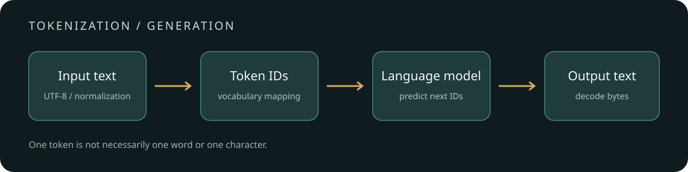

# 从字节到 token：理解分词、生成和成本

[English](README.en.md)

同一句话，换一个模型，token 数可能不同。token 数决定文本占用多少上下文，也会影响按 token 计费的 API 成本。理解 tokenizer 可以帮助我们估算输入规模、排查乱码和截断问题，并在选择模型时避免把字数直接当成 token 数。

本实验提供一个可从零运行的字节级 BPE，以及一个使用真实 tokenizer 的对比脚本。示例只展示编码差异，不把玩具语料上的数字当作模型排行榜。



```text
原始文本 → 预处理 / 规范化 → 切分与词表映射 → token ID → 模型
                                         ↑ 模型产生的 token ID → 解码 → 文本
```

## 先运行：12 次合并如何改变文本

无需下载模型，Python 3 即可运行：

```bash
python toy_bpe.py
python ngrams.py
```

`toy_bpe.py` 用三行自建英文字符串训练：每次统计语料中相邻字节片段对的出现次数，选频次最高的一对并合并；同频按字节序决定。初始词表包含全部 256 个单字节，学习 12 条合并规则；编码新文本时按学习顺序重放这些规则，解码时拼接字节，再按 UTF-8 解码。它没有正则预切分、特殊 token、模型模板和工程优化，不能替代真实模型的 tokenizer。

在这份固定代码与语料上，`low lower` 的 9 个 UTF-8 字节变为 2 个 token，而未进入训练语料的 `你好🙂` 仍需 10 个 token。后者编码时每个字节各占一个 token，并不意味着中文或 emoji 在其他 tokenizer 中一定如此。两个样例都可还原原文；脚本也检查空格与换行。

`ngrams.py` 把既有 notebook 的核心函数整理为命令行程序：演示连续字符或按空格切出的词的 n-gram。它是统计窗口，不是训练好的 BPE；词模式会先转小写并删除标点，再按空白切分；因此 `red,blue` 会变成一个词 `redblue`，它不是通用或中文分词器。这里的 unigram 是长度为 1 的 n-gram，和下文的 Unigram 分词模型并非同一概念。

## 三种常见方法

| 方法 | 训练思路 | 切分时如何选 | 需要留意 |
| --- | --- | --- | --- |
| BPE | 从基本单位开始，不断合并常见相邻片段 | 使用词表与合并顺序切分 | 字符 BPE 与字节 BPE 的初始单位不同；预切分会限制合并范围 |
| WordPiece | 学习子词词表；公开教学中的目标依据片段关联程度 | 常见实现按最长匹配切分，续接子词可用 `##` 标记 | 具体训练实现不同；无法表示的词可能变成 `[UNK]` |
| Unigram | 从较大的候选词表开始，以语言模型概率拟合并逐步裁剪 | 在候选切分中选择概率高的路径，也可采样 | 并非只按频次贪心合并；规范化和未知字符处理影响还原 |

对于一条候选切分 $s=(t_1,\ldots,t_n)$，Unigram 模型通常将其分数写作 $P(s)=\prod_i P(t_i)$；确定性切分选使该分数最大的合法路径。BPE 的合并次序、词表和预处理必须与模型训练时一致，仅知道算法名称还不够。

SentencePiece 是分词工具，支持 BPE 和 Unigram，而不是第三种与它们并列的算法。它默认会做 `nmt_nfkc` 规范化和空格处理，所以解码可能还原规范化后的文本而不是字节级原文。未知字符使用 `<unk>` 时也可能丢失原文；启用 byte fallback 可处理未登录字符，但不会撤销规范化造成的变化。具体设置以模型文件为准。

## 比较真实编码器

```bash
pip install tiktoken
python compare_tiktoken.py
```

脚本对同一组中英文、emoji、空格和换行，比较 `r50k_base` 与 `cl100k_base` 的 token 数、ID 和每个 token 对应的原始字节，并断言拼接后可还原。首次运行可能需要联网获取词表。两者的词表与规则不同，ID 不能混用；脚本使用编码器名称，不声称它们代表所有模型的当前配置。

一次 CPU 运行使用 `tiktoken 0.14.0`：`你好🙂` 在 `r50k_base` 中是 6 个 token，在 `cl100k_base` 中是 4 个；两个编码器对 `low lower` 均为 2 个。这个极小样本说明同一文本的计数会随词表变化，不能据此推断整个语种的压缩效率。

单个字节级 token 可能只是一个 UTF-8 字符的一部分，逐 token 转为字符串可能出现替代字符；应先拼接字节再解码。流式输出也需要保留不完整字节，不能假设一个 token 恰好等于一个汉字或一个词。

## token 和生成、计费有什么关系？

对于常见自回归生成，输入先变为 token ID；模型根据已有上下文给出下一个 token 的概率分布，采样或选择一个 token，再继续下一步，直到停止。生成速度的 token/s 受到模型、硬件、批处理、上下文长度和解码配置等影响，不能直接换算成固定字数每秒；推测解码等实现也可能改变执行方式。

按输入与输出 token 分开计价时，一个简化估算是：

$$\text{费用}=\frac{N_{in}}{10^6}P_{in}+\frac{N_{out}}{10^6}P_{out}$$

其中价格单位是每百万 token 的费用。实际账单还要按供应商口径处理缓存、音视频、工具调用、推理 token 等；消息模板与特殊 token 也可能占用上下文。应以服务返回的 usage 与当时价格为准，不能直接用本地对纯文本的计数替代账单。

## 资料与实现

- [Hugging Face Tokenizers：算法概览](https://huggingface.co/docs/tokenizers/components)：各环节与模型组件。
- [Hugging Face：WordPiece 原理](https://huggingface.co/learn/llm-course/chapter6/6)：关联评分与最长匹配的教学解释，并说明原始训练算法未完整公开。
- [SentencePiece 项目](https://github.com/google/sentencepiece) 和 [规范化设置](https://github.com/google/sentencepiece/blob/master/doc/normalization.md)：原始文本、模型类型与规范化边界。
- [tiktoken 源码](https://github.com/openai/tiktoken)：实际字节级编码与解码实现。
- [OpenAI token 计算说明](https://platform.openai.com/docs/guides/tokenizer)：模型输入输出 token 和计数口径。
