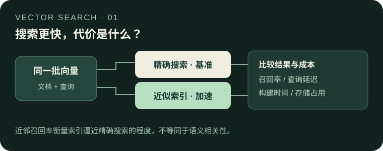

# Choosing a vector database: from exact search to index benchmarks

[中文](README.md)



When a collection of documents grows, retrieval needs to return nearby vectors within a practical latency and memory budget. This project explains how to design a comparison across indexes and databases using the same data: measure approximate-neighbor recall, query latency, build time and storage together instead of ranking products on one number.

**Scope:** the historical runs were on a Windows CPU machine, not DGX Spark. Their raw JSON results are missing. The historical numbers illustrate experimental conditions and methods; they do not support independently verifiable product rankings.

## Why a faster index can miss neighbors

Exact search compares a query with every vector and can serve as the reference. Approximate nearest neighbor (ANN) indexes reduce work by organizing, pruning or compressing vectors, at the cost of potentially missing exact neighbors. For the historical experiment, exact neighbors were computed using squared Euclidean distance. Per query:

$$\mathrm{Recall@}k = \frac{|\mathrm{ANN}_k \cap \mathrm{Exact}_k|}{k}$$

For example, recovering nine of the exact top ten yields 0.9. The reported recall is averaged across queries. **This measures agreement with exact vector search, not semantic relevance to users.** Judging the latter requires relevance labels, representative data and a separate evaluation.

Choose an acceptable recall target first, then compare latency, construction and space for configurations that meet it. HNSW search width is one way to trade search work for recall; parameter names and semantics vary by implementation and need separate validation.

## Historical setup and what it can support

| Item | Historical record |
|---|---|
| Host | Windows 11, Ryzen 9 5900HX, 64 GB RAM; CPU execution |
| Data | English 20 Newsgroups text encoded with all-MiniLM-L6-v2 into 384-dimensional vectors; about 11,293 document vectors and 40 queries recorded |
| Systems | Milvus and Qdrant in Docker; SurrealDB as a native Windows process; embedded LanceDB, ChromaDB and sqlite-vec |
| Measurements | Exact top-10 neighbor recall, query latency, index build time and incremental storage |

Indexes, parameters and deployment modes differed, so these are comparisons **between configurations**, not causal estimates of the database alone. The data preparation script filters some short texts, so use the actual generated record count when rebuilding.

One historical record reports Milvus HNSW with `ef=64` at 4.1 ms median latency and 0.985 Recall@10; LanceDB HnswPq was recorded at 5.0 ms and 0.538. These differing indexes show why recall and latency must be inspected together. The raw results are absent and neither pair establishes a product ranking. The small English query set and mixed deployment modes cannot establish Chinese retrieval quality or production concurrency performance. See the [historical index report](reports/向量索引-召回延迟与存储.md) for conditions and limits.

## Run a safe synthetic exact-search check

Legacy multi-system scripts can delete fixed-name collections or files; some entry points are disabled. Other historical scripts are not all guarded: for example, `gen_emb.py` writes to a fixed path and can overwrite a file. Do not run those scripts directly. The following example uses an in-memory SQLite database and synthetic vectors only; it does not connect to an existing database or read or write user files. It is an exact-search measurement example, not a cross-product benchmark.

```bash
python -m pip install numpy sqlite-vec
python scripts/safe_sqlite_bench.py --vectors 1000 --queries 20 --dimensions 32
```

The output reports mean Recall@10 and median query time. Timing includes Python query-vector serialization, SQLite execution and result fetching; there is no separate warmup and the first query is included. NumPy float32 squared L2 distances provide the reference. When the tenth distance is tied, closer neighbors take priority and tied IDs count only up to the remaining places; this differs from the historical fixed-ID intersection metric. Ties use exact equality of NumPy float32 results; rounding can differ across implementations, so this is not exact real-number distance. The output records the seed and dependency versions. Timing depends on platform, scale and thread settings. The historical multi-database tests require a fresh isolated design before running; see the [environment and method notes](环境搭建.md).

## Further material

The following detailed documents are currently in Chinese:

- [Selection research](docs/向量数据库选型调研.md): deployment, index choices, official device requirements and source-code counting methods.
- [Historical index report](reports/向量索引-召回延迟与存储.md): measurements, limitations and evidence needed for a rerun.
- [Memory measurement](reports/内存占用-测量范围与方法.md) and [hybrid search](reports/混合检索-向量与关键词融合.md): measurement scope and vector/keyword fusion.
- [Environment](环境搭建.md), [debugging notes](docs/调试与排错记录.md), [project background](docs/项目与维护背景.md), [Chinese tokenizers](docs/六库分词器实现与中文支持.md), and [storage accounting](docs/各库体积与安装包数据.md): dated sources and measurement constraints.
