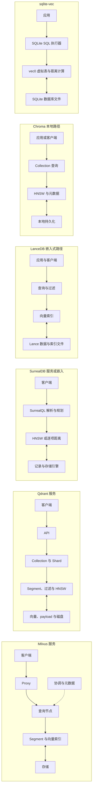

# 向量数据库选型：架构、源码与部署条件

调查日期：**2026-11-07**。本文面向本实验涉及的 Milvus、Qdrant、SurrealDB、LanceDB、Chroma 和 sqlite-vec。先按应用需要的部署方式、过滤与数据规模筛选，再在同一数据和召回率条件下测量延迟与资源。历史实验结果缺少原始 JSON，不足以证明哪个产品总体更快。

产品的开源版本、托管服务和商业版本并非同一个部署形态；以下能力以链接中的具体版本文档为准。源码快照与实验历史运行版本并非一一对应，不能用新版本的功能倒推旧测试的行为。

## 先缩小候选

| 需求 | 可先试 | 需要继续核实 |
|---|---|---|
| 单进程、已有 SQLite 数据 | sqlite-vec | 本实验版本的索引能力和数据增长后的全量搜索成本 |
| 本地 Python 原型，之后可能转服务 | Chroma、LanceDB | 本地与服务端的能力差异、运维和迁移成本 |
| 专门的向量服务、向量与过滤结合 | Qdrant | 元数据索引、分片副本和过滤选择率 |
| 多节点与多种索引组合 | Milvus | 组件数、内存、对象存储及日志组件的运维成本 |
| 同时需要文档、图关系和向量查询 | SurrealDB | 数据模型、SQL 查询计划和向量索引是否命中 |

这是确定候选的起点，不是跑分排名。量级、过滤条件、更新频率、容灾、权限、许可证和现有技术栈都能改变选择。

## 部署架构与检索路径

下图是为理解查询路径而作的简化图，不是完整的高可用部署拓扑。单机与分布式版本的内部组件和持久化方式不同。

Milvus 的 [Standalone 与 Distributed](https://milvus.io/docs/install-overview.md) 架构不同：前者适合单机运行，后者将读取与写入相关组件分开部署。Qdrant 对稠密向量使用 [HNSW](https://qdrant.tech/documentation/manage-data/indexing/)，过滤还涉及 payload 索引；其磁盘存储和分片设置会改变资源占用。[Chroma 分布式架构](https://docs.trychroma.com/references/architecture/distributed)另有网关、日志、查询执行器、压实器与对象存储，不应套用图中的本地路径。

SurrealDB 把查询规划与向量检索并入多模型数据库，明确可用精确遍历、HNSW，较新版本还提供 DiskANN；实际是否命中索引应检查 `EXPLAIN FULL`。[官方向量索引说明](https://surrealdb.com/docs/learn/data-models/vector-search/vector-indexes)。LanceDB 通过 Lance 管理列式数据和索引，嵌入式调用与远程服务也不是同一种运行边界。[LanceDB 索引 API](https://lancedb.github.io/lancedb/python/python/)。

## 向量索引选项与查询成本

| 产品 | 官方文档列出的代表性选项 | 路径差异 |
|---|---|---|
| Milvus | FLAT、IVF 系列、HNSW、DiskANN，以及依版本和环境提供的 GPU 索引 | FLAT 扫描，IVF 先选分区，HNSW 走邻接图，DiskANN 引入磁盘 I/O；见[索引说明](https://milvus.io/docs/index-explained.md) |
| Qdrant | 稠密向量 HNSW；也支持量化、payload 索引和精确搜索 | HNSW 搜索宽度与过滤策略影响成本；量化是向量表示方式，不是单独的 IVF 替代品。[索引](https://qdrant.tech/documentation/manage-data/indexing/) |
| SurrealDB | 暴力距离、HNSW；DiskANN 从 3.1 起 | HNSW 的图需考虑内存；DiskANN 将图与向量保存在键值存储，通过缓存访问。[索引说明](https://surrealdb.com/docs/learn/data-models/vector-search/vector-indexes) |
| LanceDB | IVF-Flat、IVF-PQ、IVF-HNSW-PQ、IVF-HNSW-SQ 等 | IVF 选择分区，PQ/SQ 压缩向量，候选精排可换取更好精度。[API](https://lancedb.github.io/lancedb/python/python/) |
| Chroma | 单节点 HNSW；分布式产品另有不同索引能力 | 单节点文档明确 HNSW 的内存约束，不能把它等同于其分布式服务。[单节点性能](https://docs.trychroma.com/guides/deploy/performance) |
| sqlite-vec | 本实验使用 vec0 逐项近邻搜索 | 运行于 SQLite 进程中；应按实际安装版本确认其他索引能力，不能以最新源码代替历史版本。 [项目源码](https://github.com/asg017/sqlite-vec) |

**版本风险：**SurrealDB 的官方索引文档称从 3.0.0 到 3.3.1 修复前，多个完全相同向量可能导致索引遗漏记录；3.3.1 修复新写入，受影响的已有索引需要重建。升级和复现实验时应核实实际版本及索引状态。[官方说明](https://surrealdb.com/docs/reference/query-language/statements/define/indexes)。

## 官方部署要求

| 对象 | 厂商公开要求或说明 |
|---|---|
| Milvus Standalone | 文档列出最低 8 GB RAM、建议 16 GB 和 4 核以上，SSD；Windows 通过 Docker Desktop 与 WSL 2，具体支持的 CPU 和依赖版本见[安装前提](https://milvus.io/docs/prerequisite-docker.md)。这不是任意数据量的容量保证。 |
| Qdrant | 支持 64 位 x86-64 和 ARM64；内存取决于向量数量、维度、payload、索引、副本及量化。持久存储要求 POSIX 兼容的块存储，不支持直接把 NFS 或对象存储当作本地数据目录。[安装要求](https://qdrant.tech/documentation/operations/installation/) |
| Chroma 单节点 | 官方不建议低于 2 GB RAM；文档还指出 HNSW 索引要考虑可用内存与换页。[单节点性能](https://docs.trychroma.com/guides/deploy/performance) |
| SurrealDB、LanceDB、sqlite-vec | 通用安装页面未提供可在所有负载下成立的单一内存最低值；应以实际版本支持的平台及数据、索引和并发测量为准。 |

厂商的最低安装要求只说明能否启动，无法决定几十万或几亿向量的实际内存。持久化原始向量、索引、字段索引、缓存、写入缓冲和副本都可能额外占空间；应分别测进程内存、磁盘增量和构建峰值。

## 源码入口和实现语言

下表固定的是本次阅读的源码提交，不代表最新版本，也不等于历史实验的运行版本。链接可直接查看对应文件；语言描述指主要实现及接口，仓库通常还包含测试、构建工具和多语言客户端。

| 项目 | 快照 | 实现与可核对的入口 |
|---|---|---|
| Milvus | `88997528bb78` | 服务与协调包含 Go，检索核心包含 C/C++；[QueryNode 搜索任务](https://github.com/milvus-io/milvus/tree/88997528bb78/internal/querynodev2/tasks)、[源码仓库](https://github.com/milvus-io/milvus/tree/88997528bb78) |
| Qdrant | `6ab21cac18eb` | Rust 服务；[HNSW 实现](https://github.com/qdrant/qdrant/blob/6ab21cac18eb/lib/segment/src/index/hnsw_index/hnsw.rs)、[搜索调度](https://github.com/qdrant/qdrant/blob/6ab21cac18eb/lib/shard/src/search.rs) |
| SurrealDB | `18971ffba781` | Rust 引擎；[查询执行器](https://github.com/surrealdb/surrealdb/blob/18971ffba781/surrealdb/core/src/idx/planner/executor.rs)、[索引代码](https://github.com/surrealdb/surrealdb/blob/18971ffba781/surrealdb/core/src/idx/index.rs) |
| LanceDB | `8c9c5c5a5f98` | Rust 核心，提供 Python、Node 等接口；[向量索引定义](https://github.com/lancedb/lancedb/blob/8c9c5c5a5f98/rust/lancedb/src/index/vector.rs)、[查询实现](https://github.com/lancedb/lancedb/blob/8c9c5c5a5f98/rust/lancedb/src/query.rs)。Lance 格式及部分底层实现位于[独立仓库](https://github.com/lancedb/lance)。 |
| sqlite-vec | `04d28bd21773` | C 编写的 SQLite 扩展；[`sqlite-vec.c`](https://github.com/asg017/sqlite-vec/blob/04d28bd21773/sqlite-vec.c) 注册 `vec0` 模块并实现查询。 |
| Chroma | 当前公开源码 | Python 接口与 Rust 组件混合；[Python 集合接口](https://github.com/chroma-core/chroma/blob/main/chromadb/api/models/Collection.py)、[Rust HNSW](https://github.com/chroma-core/chroma/blob/main/rust/index/src/hnsw.rs)。此项按在线主分支查阅，未固定源码快照。 |

### 源码规模：只看得出什么

下表统计五个数据库仓库及独立 Lance 底层仓库的固定提交；Chroma 尚未做同口径统计。方法是 `git ls-files` 枚举被跟踪文件，以扩展名划分语言，用脚本按换行符统计**物理行数**，包含空行、注释、测试和示例；路径中名为 `vendor`、`third_party`、`third-party`、`node_modules`、`target`、`dist`、`generated` 的目录被排除。统计时这些仓库的已跟踪文件均无工作树改动。`.h` 单独计为 C/C++ 头文件，因此表内 C++ 不包含 `.h`。这是仓库规模描述，不是有效代码行、工作量或性能排名；非这些扩展名的语言也不在表内。

| 固定快照 | 主要语言：文件数 / 物理行数 |
|---|---|
| Milvus | Go 3,630 / 1,538,562；Python 343 / 339,539；C++ 456 / 285,599；C/C++ 头文件 419 / 108,321 |
| Qdrant | Rust 1,822 / 494,134；Python 228 / 52,194 |
| SurrealDB | Rust 1,712 / 502,528；Python 21 / 1,657 |
| LanceDB | Rust 147 / 104,102；Python 143 / 69,840；TypeScript 53 / 22,126 |
| sqlite-vec | C 46 / 21,759；Python 47 / 13,654 |
| Lance，独立底层仓库 `7d531618d58c` | Rust 855 / 782,383；Python 221 / 76,119；Java 221 / 48,562 |
| Chroma | 没有纳入同口径固定提交统计；不能将在线主分支的文件数量与上表直接比较。 |

LanceDB 的核心依赖独立的 Lance 仓库，两者不能简单把行数当作互斥独立产品的对比。不同仓库测试、生成代码和打包范围不同，这些数字不代表生产路径的代码量。

## 项目与维护背景

GitHub 仓库创建时间用于反映公开项目历史，不等于公司成立时间或项目内部开始开发的时间。

| 项目 | GitHub 仓库创建 | 项目与公司公开信息 |
|---|---|---|
| Milvus | 2019-09-16 | Zilliz 是项目主要维护方之一；[公司介绍资料](https://resource.zilliz.com/hubfs/Webinars/Vector%20Databases%20101%20-%20slides.pdf)列其成立于 2017 年。[另一份研讨会资料](https://resource.zilliz.com/hubfs/Webinar_TruEra-rag-evals_Slides_20231026.pdf)中的模型生成介绍写 2019 年，来源性质较弱，不据此作为公司事实。 |
| Qdrant | 2020-05-30 | Qdrant 官方披露 2024 年 2,800 万美元 A 轮、2026 年 5,000 万美元 B 轮。[A 轮](https://qdrant.tech/blog/series-a-funding-round/) · [B 轮](https://qdrant.tech/blog/series-b-announcement/) |
| SurrealDB | 2021-12-09 | 官方列出 2022 年公开发布、2023 年 600 万美元种子轮、2025 年 3,800 万美元 A 轮；其当前页面注明引擎 BSL 1.1，选型时应核对目标版本的许可。[公司介绍](https://surrealdb.com/about) |
| LanceDB | 2023-02-28 | 官方在 2025 年宣布 3,000 万美元 A 轮；LanceDB 和 Lance 格式是两个相关项目。[公告](https://www.lancedb.com/blog/series-a-funding) |
| Chroma | 2022-10-05 | 官方宣布 2023 年 1,800 万美元种子轮；2026 年宣布加入 Replit。持续性应结合其开源仓库和服务条款判断。[融资](https://www.trychroma.com/company/seed) · [公告](https://www.trychroma.com/blog/chroma-joins-replit) |
| sqlite-vec | 2024-04-20 | 开源 SQLite 扩展项目；不应根据仓库存在推断其一定有独立公司或融资。 |

仓库创建日期来自各仓库 GitHub API 的 `created_at`，并非首个可用版本的发布日期。融资只记录来源明确的轮次，不把查到的轮次视作完整融资史。
