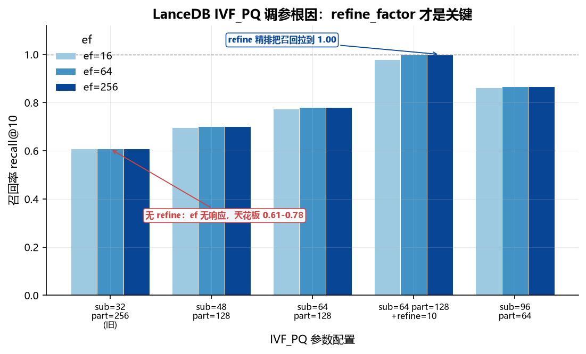

> **历史记录提示：**原始结果缺失，部分旧结论和归因未经充分验证，不能作为产品排名。请以[当前实验入口](../README.md)和主题报告为准。

# 五库向量检索对比 · 真实数据版（2026-09-03）

**这个文档是干嘛的**：本实验第一次用**真实文本 embedding** 做的五库横评，是换真实数据后的第一版基准。它确立了「召回率基准是暴力精确 top-k、数据是 20 Newsgroups」这套口径，后续的索引矩阵基准是在它基础上扩展索引维度和存储记账。要看完整的索引 × 构建时间 × 存储三段拆分，看 `2026-09-04-真实数据-索引矩阵基准.md`。本文采用各库的不同搜索配置：历史记载 LanceDB 为 IVF_PQ、sqlite-vec 为暴力扫描，其余三库使用 HNSW；没有系统扫描索引类型，也没有构建时间和存储分段。

**机器**：Windows 11，AMD Ryzen 9 5900HX（8 核 16 线程），64 GB 内存，全 CPU 推理无 GPU
**数据**：20 Newsgroups，all-MiniLM-L6-v2（384 维，max_seq 256，去邮件头截 1200 字符）
**规模**：train 11,293 篇入库，test 分层采样 40 条查询（20 类 × 2），k=10
**召回率基准**：暴力精确 top-k（L2）

上一版（`2026-09-03-随机向量专项测试.md`）用 768 维均匀随机向量，在该次配置下 LanceDB 的召回约为 0.04。向量分布与索引参数均会影响召回；随机向量不是所有 ANN 方法的统一最坏情况，也不能仅据此断言结果失真。

## 汇总

| 库 | 版本 | 写入 vec/s | ef=64 p50 | ef=64 召回 | ef=256 p50 | ef=256 召回 |
|---|---|---:|---:|---:|---:|---:|
| Qdrant | 1.19.0 | 1,608 | 5.7ms | **1.000** | 5.8ms | 1.000 |
| Milvus | v3.0.0 | 2,869 | 4.9ms | 0.988 | 5.8ms | 1.000 |
| SurrealDB | 3.2.4 | 714 | 6.1ms | 0.984 | 7.5ms | 0.9975 |
| LanceDB | 0.38.0 | **29,377** | 14.4ms | 1.000 | 20.6ms | 1.000 |
| sqlite-vec | 0.1.9 | **31,922** | 22.8ms | 1.000 | 22.0ms | 1.000 |

## ef 扫描（p50 毫秒 / 召回率）

| ef | Qdrant | Milvus | SurrealDB | LanceDB | sqlite-vec |
|---:|---|---|---|---|---|
| 64 | 5.7ms / 1.000 | 4.9ms / 0.988 | 6.1ms / 0.984 | 14.4ms / 1.000 | 22.8ms / 1.000 |
| 128 | 5.8ms / 1.000 | 5.0ms / 1.000 | 6.6ms / 0.9975 | 19.6ms / 1.000 | 22.8ms / 1.000 |
| 256 | 5.8ms / 1.000 | 5.8ms / 1.000 | 7.5ms / 0.9975 | 20.6ms / 1.000 | 22.0ms / 1.000 |

sqlite-vec 无 ANN 索引，是暴力全表扫描，ef 参数无效，延迟平坦是预期行为。

## 分组解读

### 标准 HNSW：Milvus、Qdrant、SurrealDB

三个库延迟都在 5-8ms，召回 ef=128 即到顶。差别在写入吞吐：Milvus 2869 vec/s，Qdrant 1608，SurrealDB 714。吞吐差异同时受到部署方式、客户端和批量写入设置等影响，历史记录不足以确定原因。

SurrealDB 的 ef=64 记录为 0.984；如果确为 40 条查询、每条各 10 个结果，平均召回应以 0.0025 为步长，四舍五入到三位小数不会得到 0.984。原始结果缺失，查询数、统计口径或表格数值存在未解的不一致，无法判断该差异原因。

### IVF_PQ：LanceDB

LanceDB 是唯一用倒排文件加乘积量化的库。记录中的写入为 29,377 vec/s，查询延迟为 14–20ms；该配置使用 `refine_factor=10` 精排，但仅凭这次记录无法确定性能差异的原因。

召回高的代价是延迟：ef 从 64 到 256，延迟上升但记录召回保持 1.000；达到该测试的满召回后，不能据此判定量化误差或 nprobes 是瓶颈。

### 暴力扫描：sqlite-vec

22.8ms 且完全平坦，1 万条 384 维的暴力扫描在可接受范围。更大规模下需要另行实测，具体成本取决于实现和硬件，也可以考虑其他精确搜索实现。

## LanceDB 参数扫描（历史解释未证实）

上一版 LanceDB 召回 0.04-0.05 且不随 ef 变化，曾怀疑是 adapter 实现错误。旧参数扫描记录如下，但无法单独排除适配器或其他设置的影响：

| IVF_PQ 参数 | ef=16 | ef=64 | ef=256 |
|---|---|---|---|
| sub=32 part=256（旧） | 0.608 | 0.608 | 0.608 |
| sub=48 part=128 | 0.696 | 0.702 | 0.702 |
| sub=64 part=128 | 0.774 | 0.780 | 0.780 |
| sub=64 part=128 + refine=10 | 0.980 | 1.000 | 1.000 |
| sub=96 part=64 | 0.862 | 0.866 | 0.866 |



*图 1 | LanceDB IVF_PQ 五组参数的召回率（ef=16/64/256 三档）。这些历史配置的记录召回存在差异，但原始证据缺失且配置改变不止一项，无法据此确定瓶颈或单一原因。*

不同数据和参数下的召回记录分别为约 0.61 和 0.04；由于有多项变量同时改变，不能将差异归因于单一原因。

旧参数扫描中召回未随所列 ef 变化，精排配置的记录召回更高；仅凭这些记录不能确定参数是否生效，也不能确定性能瓶颈或归因。

## 测试过程记录

### Embedding 生成

- 模型 all-MiniLM-L6-v2 本地加载，384 维 float32
- 本机 CPU 推理速度是决定性约束：`max_seq_length=512` 时 11-14 docs/s，全集要 28 分钟；改 256 后 40 docs/s，全集 6.7 分钟。384 反而只有 18 docs/s（padding 到 384 更浪费），不是线性关系
- 必须去掉邮件头：20 Newsgroups 的 header（From/Subject/Organization）占前几百 token，不剥掉会把正文挤出 256 token 窗口
- train 11,293 篇 + test 600 篇（每类 30），npz 17MB

### 已知遗留问题

- 向量范数均值 1.89，未做归一化。如果后续要换余弦相似度语义，需要重跑 embedding
- SurrealDB 精度处理对召回的影响缺少隔离对照，ef=64 数值及原因均待核实
- LanceDB 的 refine 精排与其余四库的纯 HNSW 不同构，延迟对比需单列标注

## 历史命令（已禁用）

以下命令保留供理解旧测试流程；其中 `probe_lance.py` 和 `multi_bench.py` 入口已禁用，不能直接复现。当前可运行的隔离示例见[实验入口](../README.md)。

```bash
# 1. 生成 embedding（约 7 分钟）
./.venv/Scripts/python.exe scripts/gen_emb.py

# 2. LanceDB 参数对照实验（可选，验证根因）
./.venv/Scripts/python.exe scripts/probe_lance.py

# 3. 五库对比
./.venv/Scripts/python.exe scripts/multi_bench.py --real --only surreal
./.venv/Scripts/python.exe scripts/multi_bench.py --real --only milvus qdrant lance sqlite
```

结果文件：`results/multi-real-20news-*.json`
