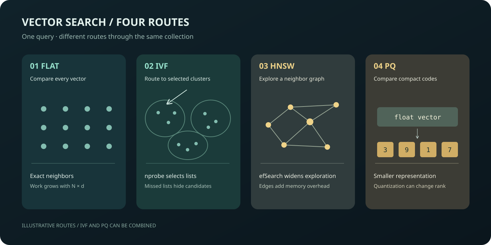

# Vector indexes: choosing between recall, speed, and space

[中文](README.md)



Exact search compares a query with every stored vector. Approximate indexes reduce the candidates searched or compress vector representations, trading accuracy for resource use. This experiment explains Flat, IVF, HNSW, scalar quantization and product quantization, and measures their trade-offs on synthetic and historical text vectors. It provides a starting point for evaluating semantic search and retrieval systems on your own data.

The [index mechanics and selection guide](docs/索引原理与选型.md), [synthetic benchmark](docs/合成向量索引对照.md), and [historical text-vector benchmark](docs/文本向量索引对照.md) contain the detailed Chinese explanations, measurements and limitations.

## One measured comparison

An existing record identifies its inputs as normalized 384-dimensional vectors for 11,293 20 Newsgroups documents and 600 queries. Faiss CPU used one thread; Flat inner-product search supplied the exact top-10 reference. Time is the median of three full-batch timings divided by the number of queries, not a single-request percentile.

| Index and parameters | Recall@10 | Batch average ms/query |
|---|---:|---:|
| Flat | 1.0000 | 0.0715 |
| IVF, nlist=1024, nprobe=8 | 0.8180 | 0.0245 |
| IVF, nlist=1024, nprobe=32 | 0.9555 | 0.0626 |
| HNSW, M=16, efSearch=16 | 0.9342 | 0.0384 |
| HNSW, M=16, efSearch=64 | 0.9923 | 0.1099 |
| SQ8 | 0.9948 | 0.8191 |
| PQ, m=32, 8 bits | 0.6200 | 0.1334 |

Larger search ranges improved recall in this run; HNSW at efSearch=64 was slower than Flat. Timings vary with load, and latency at different recall levels is not a quality-matched ranking. The source vector file, encoder script and model revision are unavailable, so this historical measurement cannot be independently reconstructed from scratch. IVF training also used fewer vectors than Faiss recommends. See the [record and detailed limits](docs/文本向量索引对照.md).

## Search paths and cost

- **Flat** scans all vectors and provides an exact reference.
- **IVF** chooses a subset of clusters before scanning; increasing `nprobe` searches more lists.
- **HNSW** navigates a multi-layer graph; `efSearch` controls the search candidate breadth.
- **SQ/PQ** compress vectors and may alter nearest-neighbor ordering. IVF-PQ combines list selection and compression.

For each query, if the exact top-k IDs are $G_k$ and the approximate IDs are $A_k$, recall is $|A_k \cap G_k|/k$. Its average measures agreement with exact vector neighbors, not whether results answer a user's question.

For float32 vectors, Flat stores approximately $4Nd$ bytes. A PQ index with $m$ subspaces and $b$ bits per subspace uses approximately $N\lceil mb/8\rceil$ bytes for codes and $4d2^b$ bytes for its float32 codebook, assuming $d$ is divisible by $m$. IVF adds list IDs and centroids; HNSW adds graph storage. These estimates exclude process overhead, allocator fragmentation, query workspace and replicas. The guide shows the derivations and the limits of each estimate.

## Reproduce the synthetic benchmark

From this experiment directory in an isolated Python environment:

```bash
python -m pip install faiss-cpu==1.13.2 numpy==2.5.4
python scripts/benchmark_synthetic.py --out /tmp/vector-index-synthetic.json
```

The script builds 20,000 normalized Gaussian database vectors and 200 independent queries, then compares twelve configurations using squared L2 distance. It records build time, three batch search times, recall and serialized size. The [saved run](evidence/synthetic_n20000_d128_20261107.json) is a measurement on one machine; its timings are not production latency or peak memory, and the synthetic distribution is not a substitute for real embeddings. See [synthetic benchmark details](docs/合成向量索引对照.md).

The [text-vector script](scripts/verify_recall_real_corpus.py) needs prepared float32 files and metadata. The [conversion script](scripts/prepare_corpus_from_20news.py) converts an existing NPZ; it does not download text or generate embeddings. Only use trusted NPZ input because the converter allows NumPy pickle objects. Commands and input requirements are in the [Chinese README](README.md#如何动手).

The [cost calculator](scripts/vector_index_model.py) estimates storage and computational work under simplified assumptions. It does not predict recall or production latency. Compare alternatives using representative data, similar recall targets, and measured build, query, update and memory costs.

References: [Faiss index types](https://github.com/facebookresearch/faiss/wiki/Faiss-indexes) · [Faiss distance metrics](https://github.com/facebookresearch/faiss/wiki/MetricType-and-distances) · [Vector database benchmark](../vector-db-benchmark/README.en.md).
