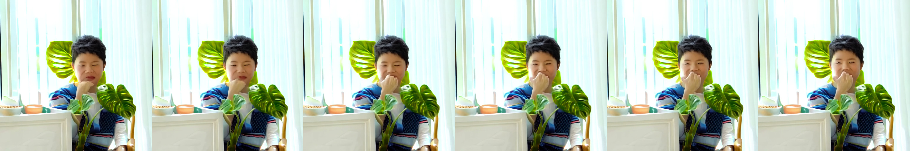
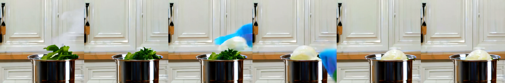
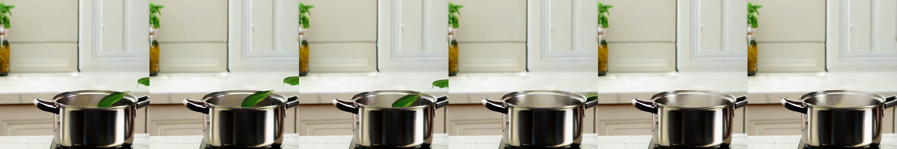

# Wan2.2 视频生成 LoRA：合成玩具鸭的场景适配

本实验尝试用少量合成视频和触发词 `rzqduck`，让 Wan2.2-TI2V-5B 在不同场景生成带红领结的黄色橡皮鸭。训练对象是玩具，不是真人；这里不能证明模型学会了某个人的身份。

实验保留三轮配置、数据生成脚本和部分生成帧。现有展示帧显示某些水景和窗台样例出现了鸭子，厨房样例未见明确鸭子。评估只有单次采样及有限场景；三轮同时更改样本、caption 和步数，不能确定哪一项导致差异，也不能据此证明某个场景存在结构性障碍。

## 方法与价值

给模型少量视频和文字标注，用低秩适配器学习特定主体，可能减少针对新主体重新训练整个模型的资源需求。本实验用于理解视频模型的数据准备、LoRA 训练和成对生成流程。是否能推广到真人、保持人物身份或产生自然长视频，需要独立数据和评估。

训练输入为视频及同名 caption。视频由视频 VAE 编码为时空 latent，文本编码提供条件；LoRA 学习部分层的低秩更新。推理输入是提示词、随机种子及可选的 LoRA 权重，输出视频。训练损失不能直接衡量人物身份、画质或运动自然度。

## 数据与训练记录

训练视频由底模根据文本合成，原始素材和训练权重不在本仓库。根据历史记录：

| 轮次 | 训练样本 | 标注 | 步数 | 主要变化 |
| --- | --- | --- | ---: | --- |
| v1 | 12 段，7 水景、5 其他 | 含鸭子外观描述 | 300 | 初始数据 |
| v2 | 18 段，7 水景、11 其他 | 精简为触发词与动作 | 400 | 新增样本、改 caption、增加步数 |
| v3 | 22 段，11 水景、11 其他 | 沿用 v2 风格 | 600 | 新增样本、增加步数 |

生成脚本设置 512×512、81 帧和 24 fps；训练配置设置 49 帧、rank 32、alpha 32、batch size 1、学习率 1e-4。数据构成和训练参数来自仓库脚本与配置。原始训练视频、权重、完整运行日志和全部环境快照未随本仓库发布，因此无法独立重建并核验每次运行，也不能保证重新生成的数据逐字节相同。

## 对照如何解读

历史评估使用固定提示词与 seed 42，导出训练前后的视频帧拼图。要将前后差异归因于适配器，必须在同一轮成对比较中固定底模、提示词、种子、采样器、尺寸及其他设置；不同轮次或提示词之间改变了多项条件，不能当作单变量实验。固定随机种子也不保证不同软件或硬件生成完全相同的结果。

以下只是留存帧的入口，具体观察应与实际画面一起审阅：

| 示例 | 训练前 | 训练后 |
| --- | --- | --- |
| v1，窗台 |  |  |
| v3，窗台 |  |  |
| v3，厨房 |  |  |

单张帧网格不能验证跨帧连续性、运动真实性或身份一致性。若要测试 caption、样本比例或训练步数的作用，应固定其他条件并使用多个随机种子，保留完整视频，对目标主体、场景服从、质量和运动分别盲评。

## 复现与许可

[实验入口](../README.md)提供数据生成、训练和评估命令；`config/` 使用原机器的绝对路径，运行前需要按自己的环境修改。底模、工具和生成素材的许可及适用限制需分别核对。生成数据并不自动获得训练真实人物或公开真人视频的授权。
