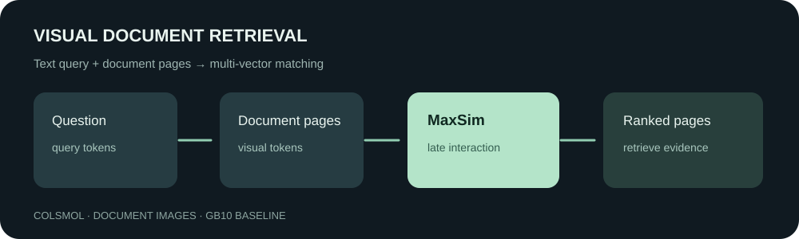

# Visual document retrieval with ColSmol

Finding the page that answers a question in reports and tables often requires OCR and a text index. Visual document retrieval offers a different route: encode the page as an image and match the question against its visual representation. We tested the roughly 256M-parameter ColSmol model on 100 held-out DocVQA page candidates.



On DGX Spark, Recall@1 was **0.55**, Recall@5 **0.78**, and nDCG@5 **0.6664**. These are results for this small fixed candidate set, not an official full ViDoRe score.

## How it works

ColSmol produces multiple vectors for each question and page. ColBERT-style late interaction finds the most similar page vector for each query vector and sums those similarities:

$$s(q,d)=\sum_i\max_j \widehat{q_i}^{\mathsf T}\widehat{d_j}.$$

This allows different parts of a question to match different page features, at the cost of storing and comparing multiple vectors. The experiment does not measure full-corpus indexing or online serving latency. See the [ColPali paper](https://arxiv.org/abs/2407.01449) and [model card](https://huggingface.co/vidore/colSmol-256M).

## Data and results

The [ViDoRe DocVQA test subset](https://huggingface.co/datasets/vidore/docvqa_test_subsampled) pairs document-page images with questions. In dataset order, we selected the first 100 distinct `image_filename` values and the first associated question for each page. Each query is ranked against all 100 pages; its paired page is treated as the only known positive.

| Metric | Result | Interpretation |
|---|---:|---|
| Recall@1 | 0.55 | Known paired page ranked first |
| Recall@5 | 0.78 | Known paired page ranked in top five |
| nDCG@5 | 0.6664 | Gives more credit to earlier ranks |

Other pages may also be relevant but unlabeled. The 100-page candidate pool cannot establish full-corpus retrieval quality. The pretrained model was evaluated without further training. Its model card reports that the original training set did not share multipage PDFs with ViDoRe; this does not rule out overlap in backbone pretraining.

[baseline100.json](baseline100.json) contains anonymous per-query positive ranks, with no images, question text, or original dataset IDs. `python recompute.py` checks the aggregate metrics from those ranks; it cannot independently establish the underlying model scores or relevance labels.

## Run the baseline

The run used Linux on NVIDIA GB10, BF16, PyTorch 2.14.0+cu130, Transformers 4.56.2, ColPali Engine 0.3.13, PEFT 0.17.1 and Datasets 4.1.1. Fetch the data and model weights from their original sources:

```bash
python -m pip install 'transformers==4.56.2' 'colpali-engine==0.3.13' 'peft==0.17.1' 'datasets==4.1.1' huggingface_hub
python -c "from huggingface_hub import snapshot_download; snapshot_download('vidore/colSmol-256M', revision='c79b633e17e060cc109b11aa2bf92a1517d3bd6f', local_dir='model')"
python -c "from huggingface_hub import snapshot_download; snapshot_download('vidore/ColSmolVLM-Instruct-256M-base', revision='99ca96f1f6b95b3a69e6abef74a2416cb738fed0', local_dir='base')"
python prepare_data.py --output data
python baseline.py --data data --base base --model model --out /tmp/visual-smoke.json --count 10
python baseline.py --data data --base base --model model --out /tmp/visual-baseline100.json --count 100
```

The published checkpoint is an adapter: load the specified base first, then the adapter. The base alone is not a trained retriever. The run took 78.12 seconds for encoding and pairwise scoring, excluding model and data loading; peak PyTorch allocation was approximately 2.81 GiB, not total system memory. The script retains a 50 GiB available-memory guard used on this machine; it is not a general model requirement.

The model card notes that current ColPali Engine prompting differs from the original training format. This run used version 0.3.13, so its result should not be compared directly with the model-card score. Software, hardware and floating-point changes can affect ranks. The 10-page run only checks the environment; the result above comes from 100 pages.

## Licensing and future work

The model and base repository metadata list MIT; the base card describes the backbone as Apache-2.0 and adapters as MIT. The model card also contains a ColQwen2 licensing paragraph, so verify the applicable files and upstream terms before redistributing weights. The ViDoRe card lists MIT; observe original DocVQA and underlying document terms as applicable. No dataset pages, question text or model weights are redistributed here.

A small supervised fine-tuning experiment on synthetic pages is described below. Teacher-score distillation has not been run.

## LoRA fine-tuning on synthetic reports

We generated 160 fictional operations reports, each containing a site identifier and three fields: revenue, units shipped and inventory. Questions ask which report contains a particular field value. All 480 values are unique and do not overlap any page-header identifier, preventing a shortcut based on the site ID. [generate_synthetic.py](generate_synthetic.py) creates these pages without using DocVQA images.

The split is by unique site: 96 training, 32 validation and 32 test pages, with three queries per page. Page hashes are distinct and site IDs do not overlap across splits. The same visual and question templates are shared, however, and matching digits may itself be a shortcut. This controlled workflow test does not establish generalization to real documents, new layouts or semantic understanding. Page rendering uses DejaVu Sans; different font versions can change pixels.

We continued training the pretrained ColSmol adapter with LoRA. Each batch pairs queries and page images, using the other page as a negative. ColPali Engine's `ColbertLoss` applies in-batch cross-entropy to query-length-normalized MaxSim scores:

$$\mathcal L=-\frac{1}{B}\sum_i\log\frac{\exp(\bar{s}(q_i,d_i)/\tau)}{\sum_j\exp(\bar{s}(q_i,d_j)/\tau)},\quad\tau=0.02.$$

The fixed run used eight steps, batch size two, AdamW at 1e-5 and seed 20261107. A two-step smoke run used validation pages. The formal comparison ranked 96 held-out queries against the same 32 test pages:

| Condition | Recall@1 | Recall@5 |
|---|---:|---:|
| Original model | 87/96 = 0.9063 | 96/96 = 1.0000 |
| Fine-tuned | 88/96 = 0.9167 | 96/96 = 1.0000 |

Three queries moved to first place and two moved away from it, a net gain of **1/96**. This does not establish a stable improvement: there is one training seed, the 96 queries come from only 32 pages, and the baseline is already high. Peak PyTorch allocation was approximately 7.68 GiB, not total machine memory. No teacher distillation or equal-budget alternative was tested.

```bash
python generate_synthetic.py --output synthetic
HF_HUB_OFFLINE=1 python train_synthetic.py --root synthetic --base base --adapter model --out train-smoke --smoke
HF_HUB_OFFLINE=1 python train_synthetic.py --root synthetic --base base --adapter model --out train-formal --steps 8
python recompute_training.py
```

The training script uses the environment above and retains its 50 GiB available-memory monitor. [synthetic-train-results.json](synthetic-train-results.json) records individual ranks and losses, not weights. The recomputation checks metrics and changes but cannot verify original model outputs from ranks alone. Regenerating the data on the same machine reproduced the original `records.json` SHA-256. The synthetic text and page contents are generated by the script and contain no external dataset material.
