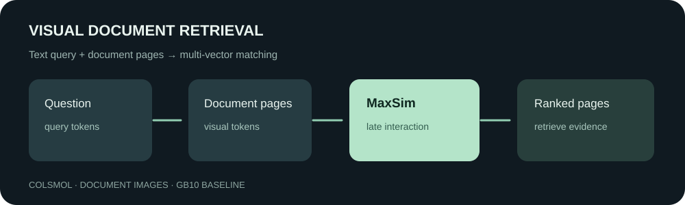

# 用 ColSmol 检索文档页面：多向量匹配实测

[English](README.en.md)

要从几百张报告、表格和图表页面中找到回答问题的一页，通常先要 OCR，再对识别文本建索引。视觉文档检索提供另一条路径：直接把页面作为图片编码，让检索模型同时利用文字、布局和图表信息。本实验使用约 256M 参数的 ColSmol，测量它在 100 个候选页面中定位已知相关页面的表现。



在 DGX Spark 的本次测试中，100 条问题的 **Recall@1 为 0.55，Recall@5 为 0.78，nDCG@5 为 0.6664**。即 55 条问题的已知配对页排在第一，78 条排在前五。这是小规模固定候选实测，不能当作完整 ViDoRe 榜单成绩。

## 模型怎样匹配问题和页面

普通单向量检索把整段内容压缩成一个向量；ColSmol 为问题和页面分别生成多个向量，采用 ColBERT 风格的延迟交互。每个问题向量与最相似的页面向量匹配，再将这些最大相似度相加：

$$s(q,d)=\sum_i\max_j \widehat{q_i}^{\mathsf T}\widehat{d_j}.$$

模型因此可以让问题中不同部分分别寻找页面上的对应线索。更多向量也意味着更高的存储和匹配成本，实际应用通常还需要索引或候选筛选；本实验没有测量全库索引或线上延迟。原理参见 [ColPali 论文](https://arxiv.org/abs/2407.01449)及 [ColSmol 模型卡](https://huggingface.co/vidore/colSmol-256M)。

## 数据、方法和结果

[ViDoRe DocVQA 测试子集](https://huggingface.co/datasets/vidore/docvqa_test_subsampled) 包含文档页图像及针对页面的问题，涵盖表格、报告和表单等内容。我们按数据顺序选前 100 个不同的 `image_filename`，各取首次出现的问题。每个问题对同一组 100 页排序，以其配对页作为唯一已知正例。

| 指标 | 结果 | 含义 |
|---|---:|---|
| Recall@1 | 0.55 | 配对页排在第 1 的问题比例 |
| Recall@5 | 0.78 | 配对页进入前 5 的问题比例 |
| nDCG@5 | 0.6664 | 配对页越靠前，得分越高 |

数据可能存在其他同样相关但未标注的页面，因此这些指标只针对已知配对页。候选范围只有选出的 100 页，不代表从大型文档库全量召回的效果。原模型直接推理，没有做本次微调。模型卡称其训练集与 ViDoRe 未使用相同的多页 PDF，但这不能排除基础模型预训练阶段的数据重叠。

[匿名逐查询排名](baseline100.json)记录 100 条查询的配对页名次，不包含原始图片、问题或数据集 ID。运行 `python recompute.py` 可以从名次重新计算三个汇总指标，但不能据此验证模型打分或页面标签。

## 运行基线

本次使用 Linux、NVIDIA GB10、BF16、PyTorch 2.14.0+cu130、Transformers 4.56.2、ColPali Engine 0.3.13、PEFT 0.17.1 和 Datasets 4.1.1。下面的模型下载需要 `huggingface_hub`，数据和权重自行从上游获取，不放在本仓库。

```bash
python -m pip install 'transformers==4.56.2' 'colpali-engine==0.3.13' 'peft==0.17.1' 'datasets==4.1.1' huggingface_hub
python -c "from huggingface_hub import snapshot_download; snapshot_download('vidore/colSmol-256M', revision='c79b633e17e060cc109b11aa2bf92a1517d3bd6f', local_dir='model')"
python -c "from huggingface_hub import snapshot_download; snapshot_download('vidore/ColSmolVLM-Instruct-256M-base', revision='99ca96f1f6b95b3a69e6abef74a2416cb738fed0', local_dir='base')"
python prepare_data.py --output data
python baseline.py --data data --base base --model model --out /tmp/visual-smoke.json --count 10
python baseline.py --data data --base base --model model --out /tmp/visual-baseline100.json --count 100
```

ColSmol 的发布权重是 adapter，需要先加载指定底模，再加载 adapter；底模本身不是可直接使用的检索器。测试耗时 78.12 秒，包含编码和两两打分，不含模型与数据加载；PyTorch 峰值分配约 2.81 GiB，不等于整机内存占用。脚本保留本次机器使用的 50 GiB 可用内存保护下限，并不是此模型的通用最低要求。

模型卡提示 ColPali Engine 当前提示格式与模型训练时使用的格式存在差异；本次用的是 0.3.13 实现，因此不与模型卡结果直接比较。不同软件版本、硬件和浮点实现也可能导致排名变化。10 页运行仅用于检查环境，100 页运行才对应这里的基线。

## 许可与后续

模型及底模仓库元数据标记 MIT，底模卡正文说明骨干为 Apache-2.0、adapter 为 MIT；模型卡许可正文另有 ColQwen2 文案，重新分发权重前应核对具体文件及上游许可。ViDoRe 数据集卡标记 MIT，仍应遵守原始 DocVQA 及源文档的适用条件。本目录不再分发数据集页面、问题文本或模型权重。

我们还在自生成页面上完成了小规模监督微调和教师分数蒸馏，见下文。

## 合成报表上的 LoRA 微调

为了检查多向量模型能否按页面内容学习检索，我们生成了 160 张虚构运营报表，每页有站点编号及收入、发货量、库存三个字段。查询要求找到包含指定字段和数值的报表。480 个字段数值全局唯一，也与所有页眉编号不同，不能只靠站点编号匹配。数据由 [generate_synthetic.py](generate_synthetic.py) 生成，不使用上述 DocVQA 页面。

按站点实体划分：训练 96 页、验证 32 页、测试 32 页，每页三条查询；页面哈希全部不同，三个分组的实体互不重合。相同版式和提问模板仍贯穿分组，数字匹配也可能形成捷径，因此这只是受控流程测试，不代表对真实文档、不同版式或语义理解的泛化能力。生成脚本使用本机 DejaVu Sans 字体；字体版本不同可能改变图片像素。

从已训练 ColSmol adapter 继续做 LoRA 监督训练，使用查询与配对页面的多向量，以及同批另一页面作为负例。ColPali Engine 的 `ColbertLoss` 对按查询长度归一化的 MaxSim 分数做批内交叉熵：

$$\mathcal L=-\frac{1}{B}\sum_i\log\frac{\exp(\bar{s}(q_i,d_i)/\tau)}{\sum_j\exp(\bar{s}(q_i,d_j)/\tau)},\quad\tau=0.02.$$

训练固定 8 步、批次 2、AdamW 学习率 1e-5、种子 20261107。先用验证页做 2 步 smoke，再比较训练前后 96 条测试问题对同一组 32 页的检索结果：

| 条件 | Recall@1 | Recall@5 |
|---|---:|---:|
| 原模型 | 87/96 = 0.9063 | 96/96 = 1.0000 |
| 微调后 | 88/96 = 0.9167 | 96/96 = 1.0000 |

共有 3 条由非第一名变为第一名、2 条从第一名下降，净增 **1/96**。这不是足以证明稳定收益的结果：只训练一个种子，96 条问题来自 32 张页面，样本也并不独立。原模型的高基线和单一模板进一步限制判断。峰值 PyTorch 分配约 7.68 GiB，不等于整机内存占用；没有做教师蒸馏或等预算其他方法对照。

```bash
python generate_synthetic.py --output synthetic
HF_HUB_OFFLINE=1 python train_synthetic.py --root synthetic --base base --adapter model --out train-smoke --smoke
HF_HUB_OFFLINE=1 python train_synthetic.py --root synthetic --base base --adapter model --out train-formal --steps 8
python recompute_training.py
```

训练脚本依赖前节相同软件和 GPU；运行时保留 50 GiB 可用内存监控。公开的 [synthetic-train-results.json](synthetic-train-results.json) 包含逐查询名次与损失，不含模型权重。复算脚本检查两个指标并统计变化，但无法仅凭名次核实原始模型输出。本机以公开生成脚本重建数据时，`records.json` 的 SHA-256 与原运行一致。合成文本和页面由脚本直接生成，不含外部数据集内容。

**独立复测：** [64 张新合成页面的留出评估](independent-evaluation/README.md)中，蒸馏组 Recall@1 为 151/192，监督组为 154/192；本次未观察到蒸馏收益。页面仍共用训练模板，不能代表真实文档泛化。

## 用多模态重排序教师蒸馏

单向量图文教师 Jina v5 在这组 96 个测试查询上 R@1 为 56/96，明显低于 ColSmol 原模型的 87/96。参数更多不等于适合当前数据。我们改用 Apache-2.0 的 [Qwen3-VL-Reranker-2B](https://huggingface.co/Qwen/Qwen3-VL-Reranker-2B) 作为教师：它逐对判断问题与页面的相关性，学生仍是多向量模型。教师在测试集前 12 条查询上有 12/12 将已知正例排第一，学生是 11/12；这是选教师的初步探测，不是完整测试集教师成绩。由于先前在全部 96 条测试查询上比较 Jina 并据此选择教师，整个测试集已参与教师选择；这 12 条还用于 Qwen 可行性判断。下列结果仅供探索，不能视为独立测试集验证。

对照复用上面的 96 张训练页、32 张验证页和 32 张测试页。每步取两个不同训练页及各自一个查询，固定同一随机种子与批次，共 8 步；教师只为这些训练批次的 32 个问题–页面组合打分。教师先对每一对输出 sigmoid 分数，再对两候选做温度为 0.1 的 softmax；学生的长度归一化 MaxSim 分数以温度 0.02 做 softmax：

$$p^T_{ij}=\operatorname{softmax}_j(t_{ij}/0.1),\qquad p^S_{ij}=\operatorname{softmax}_j(\bar{s}_{ij}/0.02),$$
$$\mathcal L=0.5\mathcal L_{\mathrm{supervised}}+0.5D_{\mathrm{KL}}(p^T\Vert p^S).$$

教师分数 $t$ 是 0 到 1 的 sigmoid 输出，不是未归一化 logits；这里温度与损失权重是此次固定设置。学生每步除监督信号外还学习教师对同批候选的相对偏好。教师只参与训练，学生推理时无需加载教师。

| 条件 | Recall@1 | Recall@5 |
|---|---:|---:|
| 原始 ColSmol | 87/96 | 96/96 |
| 同预算监督训练 | 88/96 | 96/96 |
| 监督 + 教师分数蒸馏 | 88/96 | 96/96 |

相对监督组，蒸馏组有 2 条问题进入第 1 名，2 条退出第 1 名，净变化为零。两次原模型逐查询排名完全一致。本次没有显示蒸馏收益；只有 8 步、单种子、每批仅两个候选，合成模板及全部测试查询用于教师选择均限制结论。教师是逐对重排序模型，学生是多向量检索模型，不能由此比较端到端速度。

[qwen-train-scores.json](qwen-train-scores.json) 保存合成训练批次和教师分数；[synthetic-train-results.json](synthetic-train-results.json) 与 [synthetic-distill-results.json](synthetic-distill-results.json) 保存三组匿名逐查询名次。`python recompute_distillation.py` 复算指标、变化数量并检查教师分数对应的全部批次来自训练集。这只能检查记录的一致性，不能单靠排名还原模型推理。

```bash
# Qwen 2B 先从官方模型仓库下载到 qwen-model；权重不在本仓库。
PYTHONPATH=../multimodal-reranking/scripts HF_HUB_OFFLINE=1 python qwen_train_scores.py --root synthetic --model qwen-model --out /tmp/qwen-train-scores.json
HF_HUB_OFFLINE=1 python distill_synthetic.py --root synthetic --base base --adapter model --teacher /tmp/qwen-train-scores.json --out distill-formal --steps 8
python recompute_distillation.py
```

教师打分依赖仓库内 `multimodal-reranking/scripts/qwen3_vl_reranker.py` 及其 Qwen 图像处理依赖，教师与学生所需 Transformers 版本不同，实际运行使用独立环境。教师使用 BF16、最大图片像素 65536；学生蒸馏峰值 PyTorch 分配约 7.68 GiB。教师权重和蒸馏后权重不随仓库分发。Jina 教师为 CC BY-NC 4.0，本次只保留非商业研究结果，未用其分数训练上述蒸馏组。
