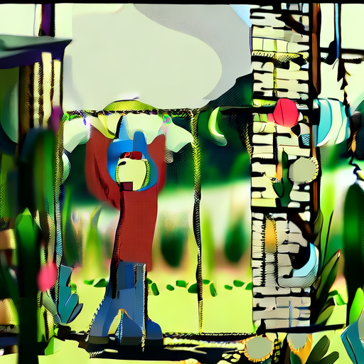

# Before fine-tuning a video model, check what the base model can generate

[中文](README.md)

A normal training loss and saved LoRA weights do not establish that a model can generate usable video. If the base output is already corrupted, a before-and-after identity comparison has no reliable foundation. This experiment documents troubleshooting of Wan2.2 TI2V 5B and provides a diagnostic script that saves images before video encoding and reports VAE numerical values.

The original training log, complete comparison videos, tensor outputs, and per-file hash records for the historical Diffusers path are not included in this repository; those observations cannot be independently verified from the published materials. The diagnostic script has not been revalidated end to end with the model. Two base-model ComfyUI videos and their configurations are provided separately below.

## Historical observation

On DGX Spark, a 200-step LoRA run used 16 videos of a self-made fictional 2D character. Two prompts absent from the training descriptions were used to compare base and LoRA output. All four outputs showed severe colored fragments. LoRA was loaded and active, but that does not establish that the model learned the character.

Changing VAE precision to FP32, excluding sensitive layers from quantization, and replacing UniPC with the trainer's Euler scheduler did not stop the base model from producing fragments. A further 17-frame unquantized BF16 base check produced a pre-encoding PNG with partially recognizable scene outlines but substantial distortion and color blocks. It had a different frame count from the previous 49-frame quantized test, so the difference cannot be attributed to quantization alone. **There was no valid before-and-after character comparison, and the root cause remains unknown.**

VAE inputs and outputs were finite, with shapes `(1, 48, 5, 32, 32)` and `(1, 3, 17, 512, 512)`. Finite values rule out NaN/Inf in those tensors, not incorrect images. Historical notes state that the VAE file SHA-256 matched the [official model file](https://huggingface.co/Wan-AI/Wan2.2-TI2V-5B-Diffusers/blob/main/vae/diffusion_pytorch_model.safetensors). One transformer shard and one text-encoder shard were also reportedly checked against official hashes; other shards were not checked individually, and the verification output is absent here.



The image above is the first frame of the 17-frame BF16 base check. A [49-frame quantized base contact sheet](evidence/base-q8-contact-sheet.jpg) shows a different configuration. Frame counts and settings differ, so they do not isolate quantization's effect.

## Test a different generation path

On 2026-11-07, the ComfyUI path previously used for water-ripple samples generated two base-model videos with held-out prompts for the same fictional character, without LoRA. Both used 49 frames, 512 × 512, seed 42, 30 Euler steps, shift 5, and CFG 5. Components were Wan2.2 TI2V 5B FP16, UMT5 FP16, and Wan2.2 VAE. The minimum observed available system memory was approximately 91.1 GiB and 90.7 GiB, respectively.

| Scene | Output | Contact-sheet observation |
|---|---|---|
| 2D character in a garden | [Video](evidence/comfy-person/prompt01_00001_.mp4) · [contact sheet](evidence/comfy-person/prompt01-contact.png) | First frame nearly black; character then mostly still, with strongly distorted color and structure. |
| 2D character walking beside a lake | [Video](evidence/comfy-person/prompt02_00001_.mp4) · [contact sheet](evidence/comfy-person/prompt02-contact.png) | First frame striped; the character gradually emerges from a thin line, with shape and image distortion. |

These outputs still do not support a fine-tuning quality comparison. The path differs from the Diffusers checks in weight format, sampler, steps, and other settings; it does not establish a shared cause or isolate a variable. Contact sheets use encoded video frames. Save original frames in this pipeline to investigate pre- versus post-encoding differences. See the [run record and hashes](evidence/comfy-person/run.json) and submitted workflows for the [garden](evidence/comfy-person/prompt01-workflow.json) and [lake](evidence/comfy-person/prompt02-workflow.json).

The ComfyUI [diffusion model](https://huggingface.co/Comfy-Org/Wan-2.2/blob/c068c8957dbc644d773ab161ea667e5f1554abd2/split_files/diffusion_models/wan2.2_ti2v_5B_fp16.safetensors), [text encoder](https://huggingface.co/Comfy-Org/Wan-2.2/blob/main/split_files/text_encoders/umt5_xxl_fp16.safetensors), and [VAE](https://huggingface.co/Comfy-Org/Wan-2.2/blob/e291a0da71012f6b8453da2150845153edf0cd92/vae/wan2.2_vae.safetensors) were each hashed and matched their corresponding releases. This rules out byte differences for those checked files, not errors in loading, numeric precision, or generation settings.

The model authors' [Diffusers example](https://huggingface.co/Wan-AI/Wan2.2-TI2V-5B-Diffusers) uses 704 × 1280, 121 frames, 50 steps, and a nonempty negative prompt; this ComfyUI check used 512 × 512, 49 frames, 30 steps, and an empty negative prompt. A full comparison under the authors' settings has not been run on this device.

## Swap seeds while holding prompts fixed

Using the same ComfyUI workflow and keeping model, 512 × 512 resolution, 49 frames, 30 steps, sampler, and CFG fixed, we exchanged the seeds previously used for the character and water prompts. The character prompt with seed 42 had produced distortion, while the water prompt with seed 610 produced recognizable ripples.

| Prompt | Seed | Output | Observation |
|---|---:|---|---|
| Garden character | 610 | [Video](evidence/seed-cross/person-seed610_00001_.mp4) · [contact sheet](evidence/seed-cross/person-seed610_00001_.jpg) | Character and garden recognizable, with a turning motion; some body details remain distorted. |
| Water ripples | 42 | [Video](evidence/seed-cross/water-seed42_00001_.mp4) · [contact sheet](evidence/seed-cross/water-seed42_00001_.jpg) | Prominent horizontal stripes; no clear ripples. |

Changing seeds accompanied a large visible change for these fixed prompts, but does not prove that the seed or an operator is the underlying cause. Two prompts and two seeds cannot estimate the probability of a normal generation. See the actual [character](evidence/seed-cross/person-workflow.json) and [water](evidence/seed-cross/water-workflow.json) workflows. The videos' SHA-256 values are `863856ca1e2ff9522960d73b1d3e12a603fc54531c7a00deadd8403df99815f7` and `3b841879a72a204a343ac6a1ad38186b33107d2317281f74f755eff24af028c7`; minimum observed available memory was 96,412,408 KiB and 96,340,968 KiB respectively.

## Check LoRA against a recognizable base result

Using the garden prompt and seed 610, the same settings and device with the 200-step LoRA loaded produced this [adapted video](evidence/seed-cross/person-lora-seed610_00001_.mp4) and [contact sheet](evidence/seed-cross/person-lora-seed610_00001_.jpg). ComfyUI logged 300 attached weight patches; before loading, 300 LoRA matrix pairs were checked against base tensor names and shapes, and the first matrix product was nonzero.

The generated character can turn, but its black and yellow clothing differs clearly from the red-clothed cartoon [training reference](evidence/seed-cross/training-reference.png). The base model also generates a character. This pair shows that loading LoRA changed the picture, not that the target character was learned or that the method works for real people. One prompt and seed cannot evaluate generalization. The [adapted workflow](evidence/seed-cross/person-lora-workflow.json) differs from the base workflow by a LoRA loading node and connection and an output prefix; the video SHA-256 is `5b0ecd1c7da7afc4c751eefeec2f59f4379ca890533be8c046adaf6025a7a3ea`, and minimum available system memory was 96,355,944 KiB.

## Repeat the base diagnostic

Prepare [Wan2.2 TI2V 5B Diffusers weights](https://huggingface.co/Wan-AI/Wan2.2-TI2V-5B-Diffusers) and compatible PyTorch, Diffusers, Transformers, PyAV, Pillow, and NumPy. The script needs a CUDA GPU; model loading and video decoding consume substantial memory. Set resource monitoring appropriate to the device. The output directory must be new; existing directories are not overwritten.

```bash
python diagnose_base.py --model /path/to/Wan2.2-TI2V-5B-Diffusers --out /path/to/output
```

The script records shapes, ranges, and non-finite values for tensors before and after VAE decoding, and saves an unencoded first-frame PNG, a six-frame contact sheet, and an MP4. Inspect the PNG first. If the PNG is sound but the MP4 is damaged, inspect encoding; if the PNG is already damaged, investigate denoising, weights, precision, model version, and decoding before blaming LoRA.

`make_data.py` can generate fictional 2D character data in the style used here. It is not real-person data and does not evaluate real-person identity retention. It creates a new output directory and refuses to overwrite an existing one. There is currently only one prompt/seed LoRA comparison of this type, which cannot establish full training effectiveness.

## Held-out fictional-character scenes

Four pairs were generated from two new scene prompts and two selected seeds using the same fictional character and 200-step LoRA. One blinded AI reviewer assessed five sampled frames per video. Neither red clothing nor a yellow scarf was marked visible in any of the four LoRA videos; obscured or indeterminate features were marked unknown rather than absent. The small sample cannot establish real-person identity retention. [Frame ratings, anonymization mapping, and scaled contact sheets](evidence/person-holdout/README.md) are available; complete videos are not distributed.
