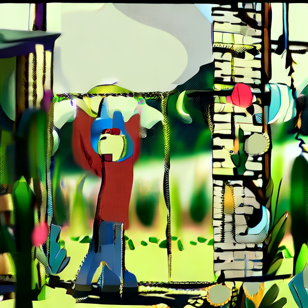

# 视频模型微调前，先确认基模能生成什么

训练损失正常、LoRA 权重保存成功，不代表模型能生成可用视频。如果基模输出本身已经破碎，拿微调前后的结果比较人物一致性就没有可靠依据。这里记录一次 Wan2.2 TI2V 5B 的排障，并提供保存编码前图像和 VAE 数值的诊断脚本。

> 历史 Diffusers 路径的原始训练日志、完整对照视频、张量输出与逐文件哈希记录未随仓库提供；该路径的观察无法仅凭公开材料独立核验，诊断脚本尚未重新完成端到端模型验证。下文另行提供 ComfyUI 路径的两段基模输出及配置。

## 观察到了什么

在 DGX Spark 上，我们使用自制二维虚构角色的 16 段视频完成了 200 步 LoRA 训练。随后用两条未出现在训练描述中的提示词做基模与 LoRA 对照，四个输出都出现严重彩色碎块；LoRA 被加载和激活，但这不能说明人物学习成功。

将 VAE 改为 FP32、量化时排除敏感层，以及把 UniPC 替换成训练器采用的 Euler 调度器，基模仍输出碎块。进一步以未量化的 BF16 模型做 17 帧基模检查，编码前 PNG 能辨认部分场景轮廓，但有明显形变和色块。它与之前 49 帧量化测试的帧数不同，因此不能将差异单独归因于量化。**这次没有得到有效的人物效果对照，根因仍未确定。**

VAE 输入和输出均为有限数值，分别为 `(1, 48, 5, 32, 32)` 和 `(1, 3, 17, 512, 512)`；数值有限只能排除 NaN/Inf，不能证明图像正确。历史记录称 VAE 文件的 SHA-256 与[官方模型文件](https://huggingface.co/Wan-AI/Wan2.2-TI2V-5B-Diffusers/blob/main/vae/diffusion_pytorch_model.safetensors)一致。记录还称 Transformer 和文本编码器各抽查了一个分片与官方哈希一致，其余分片未逐一核验；本目录没有保存这次核验输出。



上图为 17 帧 BF16 基模检查的编码前首帧；[49 帧量化基模分镜](evidence/base-q8-contact-sheet.jpg)则展示另一配置的损坏画面。两组帧数和配置不同，不能据此单独判断量化影响。

## 换一条生成路径能否得到人物基模？

2026-11-07，我们沿用此前生成水波样本的 ComfyUI 路径，以同一虚构角色的两条留出提示词生成基模视频，不加载 LoRA。两条视频各 49 帧、512 × 512，种子 42，30 步，Euler 采样，shift 为 5，CFG 为 5。模型使用 Wan2.2 TI2V 5B FP16、UMT5 FP16 和 Wan2.2 VAE；GPU 运行期间最低可用系统内存分别约为 91.1 GiB 和 90.7 GiB。

| 场景 | 输出 | 分镜观察 |
| --- | --- | --- |
| 花园中的二维人物 | [视频](evidence/comfy-person/prompt01_00001_.mp4) · [分镜](evidence/comfy-person/prompt01-contact.png) | 首帧近黑，此后人物基本静止，颜色和结构明显失真。 |
| 湖边行走的二维人物 | [视频](evidence/comfy-person/prompt02_00001_.mp4) · [分镜](evidence/comfy-person/prompt02-contact.png) | 首帧出现条纹，人物从细线逐渐出现，形态和画面失真。 |

两条结果仍不足以支持人物微调前后的效果比较。此路径与前述 Diffusers 测试的权重格式、采样器、步数和部分生成设置不同，也不能据此认定两个路径具有共同故障或将原因归于某个变量。分镜取自编码后的视频；若要定位编码前后差异，还需在这一流程保存原始帧。配置与视频哈希见[运行记录](evidence/comfy-person/run.json)，两次提交的 ComfyUI 工作流分别为[花园](evidence/comfy-person/prompt01-workflow.json)和[湖边](evidence/comfy-person/prompt02-workflow.json)。

本次 ComfyUI 使用的[扩散模型](https://huggingface.co/Comfy-Org/Wan-2.2/blob/c068c8957dbc644d773ab161ea667e5f1554abd2/split_files/diffusion_models/wan2.2_ti2v_5B_fp16.safetensors)、[文本编码器](https://huggingface.co/Comfy-Org/Wan-2.2/blob/main/split_files/text_encoders/umt5_xxl_fp16.safetensors)及 [VAE](https://huggingface.co/Comfy-Org/Wan-2.2/blob/e291a0da71012f6b8453da2150845153edf0cd92/vae/wan2.2_vae.safetensors)文件均已逐文件计算 SHA-256，与其对应的发布文件一致。这排除了这三个本地文件与所核对文件的字节差异，不能排除加载配置、数值精度或生成参数等问题。

模型作者的 [Diffusers 示例](https://huggingface.co/Wan-AI/Wan2.2-TI2V-5B-Diffusers)使用 704 × 1280、121 帧、50 步和非空负面提示词，本次 ComfyUI 检查使用 512 × 512、49 帧、30 步和空负面提示词。两者配置不同，尚未在设备上按示例完整条件进行对照。

## 复现基模检查

准备 [Wan2.2 TI2V 5B Diffusers 权重](https://huggingface.co/Wan-AI/Wan2.2-TI2V-5B-Diffusers)，以及支持该模型的 PyTorch、Diffusers、Transformers、PyAV、Pillow 和 NumPy。该脚本需要 CUDA GPU，模型加载和视频解码会消耗大量内存；运行前应结合设备状态设置资源监控。输出目录必须是尚不存在的新目录，脚本不会覆盖已有目录。

```bash
python diagnose_base.py --model /path/to/Wan2.2-TI2V-5B-Diffusers --out /path/to/output
```

脚本输出 VAE 解码前后张量的形状、数值范围及是否存在非有限值，保存未经视频编码的首帧 PNG、六帧分镜和 MP4。先检查 PNG；如果 PNG 正常而 MP4 损坏，才有理由进一步检查视频编码。如果 PNG 已损坏，应继续检查去噪、权重、精度、模型版本和解码，不能先把问题归因于 LoRA。

`make_data.py` 可生成这个实验所用风格的虚构二维角色数据。它不是现实人物数据，也不构成真实人物一致性评估。输出目录必须不存在，脚本会新建目录，避免覆盖已有数据。训练与生成的完整效果验证仍待可用基线建立后继续。
